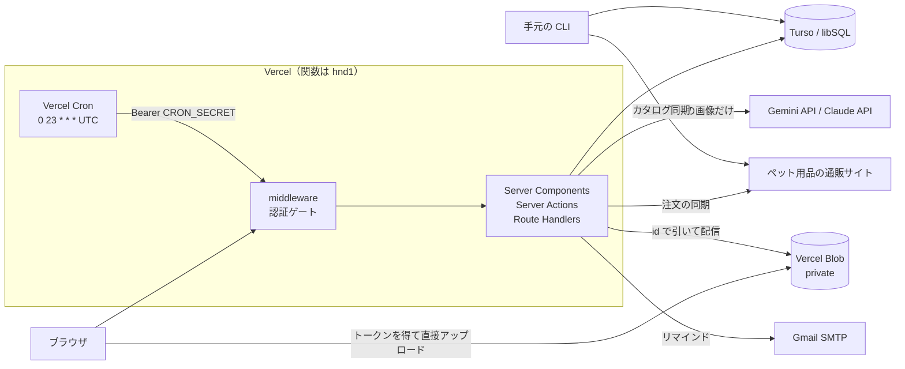
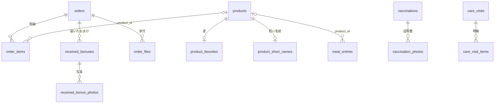
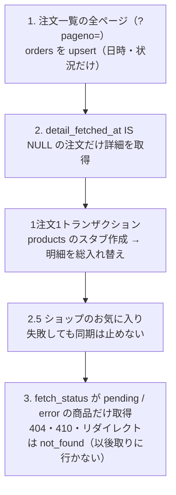
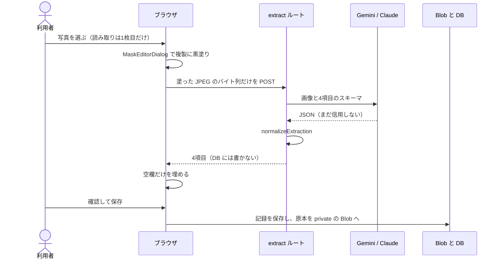
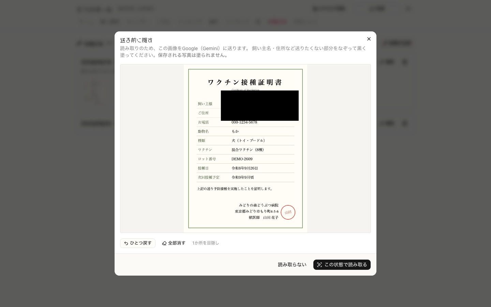

<h1 align="center">もかのほーむ — 実装詳細</h1>

本資料は、もかのほーむが **どう作られているか** をコードの水準で説明する。各機能を作った動機と実測の結果は [作品説明資料](https://github.com/mocaluna0117/moca_home/blob/main/docs/portfolio/PORTFOLIO.md) にまとめてあるので、ここでは繰り返さず、データの形・アルゴリズム・境界での守り方を、該当するファイルと関数へのリンクつきで示す。

---

## 1. 全体の構成

### 1.1 どこで何が動くか

Next.js 16 の App Router で、読み取りは Server Components が Drizzle で DB を直接引き、書き込みは Server Actions で行う。DB 接続は [`src/lib/db/index.ts`](https://github.com/mocaluna0117/moca_home/blob/main/src/lib/db/index.ts) の1本だけで、ローカルは `file:` の SQLite、本番は Turso（`libsql://`）を同じ `@libsql/client` で開く。Vercel 上で `file:` の URL が選ばれたら起動時に例外を投げ、空の DB を黙って返さない。

| 処理 | 実行場所・設定 | ファイル |
|---|---|---|
| 認証ゲート | middleware（edge runtime でビルドされる） | [middleware.ts](https://github.com/mocaluna0117/moca_home/blob/main/src/middleware.ts) |
| 注文の同期 | Route Handler（`nodejs`・`maxDuration = 300`）。進捗を NDJSON でストリームする | [api/sync/route.ts](https://github.com/mocaluna0117/moca_home/blob/main/src/app/api/sync/route.ts) |
| カタログ同期 | **手元の CLI のみ**。Vercel 上のルートは 501 を返す | [api/sync/catalog/route.ts](https://github.com/mocaluna0117/moca_home/blob/main/src/app/api/sync/catalog/route.ts), [scripts/sync.ts](https://github.com/mocaluna0117/moca_home/blob/main/scripts/sync.ts) |
| 証明書の読み取り | Route Handler（`maxDuration = 60`） | [api/vaccinations/extract/route.ts](https://github.com/mocaluna0117/moca_home/blob/main/src/app/api/vaccinations/extract/route.ts) |
| 毎朝の仕事 | Vercel Cron → `/api/cron/daily`（`maxDuration = 120`） | [vercel.json](https://github.com/mocaluna0117/moca_home/blob/main/vercel.json), [api/cron/daily/route.ts](https://github.com/mocaluna0117/moca_home/blob/main/src/app/api/cron/daily/route.ts) |
| 写真・PDF の本体 | ブラウザ → Vercel Blob に直接。関数はトークン発行と配信だけ | [api/blob/upload/route.ts](https://github.com/mocaluna0117/moca_home/blob/main/src/app/api/blob/upload/route.ts) |

関数の実行リージョンは `vercel.json` の `"regions": ["hnd1"]` で東京に固定している（8章）。



### 1.2 毎朝の定期実行

cron は `0 23 * * *`（UTC）＝ **毎朝8時（JST）** に1回だけ `/api/cron/daily` を叩く。Hobby プランの cron は1日1回なので、仕事を増やしてもパスは増やさず、この1本に相乗りさせる（認証ゲートの例外をこの1本に閉じ込めるため。7.4節）。中身は「いつものご飯の記録」→「フィラリアのリマインド」の順で、`safe()` で包んで片方が投げても他方を走らせ、両方の結果を JSON で返す。食事を先にするのは、SMTP の再試行で時間を食っても記録を落とさないためである。

### 1.3 純粋な関数と I/O の分け方

判定はすべて DB も React も import しない関数に置き（`bonus.ts`・`core-name.ts`・`vaccination-extract.ts`・`heartworm.ts`・`calendar-marks.ts`・`home.ts`・`usual-meals.ts` など）、「今日」も引数で受け取る。クエリは `queries*.ts`、書き込みは `actions*.ts` に分かれ、コンポーネントは受け取った値を描くだけにしている。10章のテストはこの純粋な層を検証している。

---

## 2. データモデル

### 2.1 テーブル

定義は [`src/lib/db/schema.ts`](https://github.com/mocaluna0117/moca_home/blob/main/src/lib/db/schema.ts) の20テーブルで、性格で4群に分かれる。

| 群 | テーブル | 書き手 |
|---|---|---|
| ショップの写し | `orders`, `order_items`, `products`, `sync_runs` | スクレイパ |
| アプリだけが書く購入まわり | `received_bonuses`, `received_bonus_photos`, `order_files`, `product_favorites`, `product_short_names` | 画面 |
| 飼育記録 | `meal_entries`, `usual_meals`, `vaccinations`, `vaccination_photos`, `care_visits`, `care_visit_items`, `care_places`, `care_courses`, `medicines`, `heartworm_doses` | 画面・cron |
| プロフィール | `dog_profile`（`CHECK (id = 1)` の1行だけ） | 画面 |



**スクレイパが上書きする表に、人が書く列を足さない。** 商品の短い名前を `products` の列にせず `product_short_names` に分けたのは、同期のたびに手で入れた値が消える危険を避けるためである。お気に入りも同じ考えで、`product_favorites` の `starred` は画面だけが、`shop_favorite`/`source` は取り込みだけが書く。画面で外した星は `starred = false` の行（墓標）として残すので、ショップ側にまだ入っていても取り込みで復活しない（[`planFavoriteImport`](https://github.com/mocaluna0117/moca_home/blob/main/src/lib/favorites.ts)）。ショップへは一切書き込まない。

### 2.2 列の規約

- **金額は整数の円**（float を使わない）。割引は負の金額の明細行で表し、トリミング・通院の合計の列は持たず常に `sum(care_visit_items.amount_yen)` で出す。金額未確定は `null` で、`0` と混ぜない
- **瞬間と暦日を分ける。** `created_at` などの瞬間は `+09:00` 付き ISO 文字列（[`nowJstIso`](https://github.com/mocaluna0117/moca_home/blob/main/src/lib/format.ts)）、`date`・`scheduled_date` などの暦日は **時差を持たない `'YYYY-MM-DD'`** で持つ。タイムゾーン変換を一度も通さないので、月の抽出も文字列比較で済む
- **スナップショット列。** `order_items.product_name`、`meal_entries.label`、`heartworm_doses.label`、`care_visits.place` は参照先と別に名前の写しを持ち、商品や登録が消えても何の記録か読める
- **個人情報の列を作らない。** 注文詳細ページに出る住所・電話、証明書の飼い主名、マイクロチップ番号や登録番号の列は無い（schema.ts 冒頭の方針）

### 2.3 索引と制約

名前付きの索引が23本（うち一意5本）ある。一意制約は列の `.unique()` ではなく **名前付きの `uniqueIndex`** で書いている。drizzle-kit push がこのリポジトリで索引や UNIQUE を作り落としたことがあり、2.4節のスクリプトが `sqlite_master` の CREATE 文を再生するとき、名前が無いと拾えないためである。

| 索引 | 効く問い |
|---|---|
| `meal_entries (date, slot)` | 日・スロット単位の読み書き、いつものご飯の「空か」の判定 |
| `meal_entries (product_id)`, `(label)` | 「この商品をいつから食べているか」（`min(date)` の集計） |
| `heartworm_doses (scheduled_date)` **一意** | 予定の一括生成をやり直しても重複しない |
| `received_bonus_photos (pathname)` **一意** | 紐づけの再送で同じ写真の行が2つできない |
| `care_places (kind, name)`, `care_courses (kind, name)`, `medicines (name)` **一意** | 同じ登録が増えない |
| `care_visits (kind, date)`, `orders (ordered_at)` | 種類別の一覧、注文の新しい順 |

`care_visits.place_id` と `heartworm_doses.medicine_id` には **DB 側の外部キーが無い**。既存テーブルへの `ALTER TABLE ADD COLUMN` で足した列で、SQLite のこの経路では `REFERENCES` が落ちるため、`deleteCarePlace()`・`deleteMedicine()` が明示的に `null` へ戻している。

### 2.4 本番 DB を壊さずに作り変える

`git push` はスキーマを運ばない。本番への反映は [`scripts/push-log-tables.ts`](https://github.com/mocaluna0117/moca_home/blob/main/scripts/push-log-tables.ts) が行い、**ローカル DB の `sqlite_master` にある CREATE 文をそのまま対象 DB へ再生する**。対象は `PUSH_TABLES` に列挙したテーブルで、次の順に3種類の変更を届ける。

1. 新しいテーブル：`CREATE TABLE IF NOT EXISTS`
2. 列の追加：`syncColumns` が `pragma table_info` を突き合わせて `ALTER TABLE ADD COLUMN`。既定値の無い `NOT NULL` 列は SQLite が後から足せないので「要手動」と出して飛ばす（だから後から足す列は必ず nullable か既定値つきにしている）
3. `NOT NULL` を外す変更：`rebuildIfLoosened` が作り直す

```ts
await target.batch([
  `drop table if exists ${tmp}`,
  createTmp,                                        // 新しい定義で <table>__new
  `insert into ${tmp} (${cols}) select ${cols} from ${table}`,
  `drop table ${table}`,
  `alter table ${tmp} rename to ${table}`,
  ...indexSqls.map(withIfNotExists),
], "write");
```

1つの batch（トランザクション）なので途中で切れても旧テーブルが残り、前後の `count(*)` が違えば終了コード1にする。**他のテーブルから外部キーで参照されている親テーブルは作り直さない**（`referencedBy` で調べ、親を DROP すると子の行が連鎖削除されるため）。

適用の順番は [DEPLOY.md](https://github.com/mocaluna0117/moca_home/blob/main/DEPLOY.md) に規則として書いてある。**スキーマが先、コードが後**（列の追加・新テーブルは旧コードでも動く）。ただし **列を消すときだけはコードが先**（旧コードがその列を SELECT しているため）。実際、おまけの写真を子テーブルへ移したときは、旧い4列を本番から DROP せずに残している。

読み方を変えるときも旧データを読めるようにしている。食事の分量は自由入力の `amount` から数値 `amount_value`＋単位 `amount_unit` に分けたが、旧列は残し、[`formatMealAmount`](https://github.com/mocaluna0117/moca_home/blob/main/src/lib/meal-amount.ts) が新しい列を優先して無ければ旧列を返す。

最初の移行は [`scripts/migrate-to-turso.ts`](https://github.com/mocaluna0117/moca_home/blob/main/scripts/migrate-to-turso.ts) で、同じく CREATE 文を再生してから、親→子の順に200行ずつ batch でコピーし、両側の件数を照合する（毎回、子→親の順に空にしてから入れ直すので、途中で止まっても再実行で直る）。

---

## 3. 購入履歴の取り込み

ショップは EC-CUBE 製で、API は無い。`fetch` と cheerio で HTML を読む（ヘッドレスブラウザは使わない）。

### 3.1 HTTP とログイン

[`HttpClient`](https://github.com/mocaluna0117/moca_home/blob/main/src/lib/scraper/client.ts) は、前回のリクエストから `SCRAPER_DELAY_MS`（既定1000ms）空ける throttle、5xx と通信エラーのときだけ2秒空けて1回やり直す再試行、`redirect: "manual"`、最小限の Cookie 入れ物を持つ。リダイレクトを追わないのは、ログイン後の 302 の行き先が成否の信号だからである。[`login`](https://github.com/mocaluna0117/moca_home/blob/main/src/lib/scraper/login.ts) はログインフォームを GET して `_csrf_token` を取り、POST する。302 の行き先がログイン画面なら失敗とする。途中でセッションが切れて解析器が `SESSION_EXPIRED` を投げたときは、`withSession` が1回だけ再ログインしてやり直す。

### 3.2 同期の段階

[`runSync`](https://github.com/mocaluna0117/moca_home/blob/main/src/lib/scraper/sync.ts) は、取得済みのものを取り直さないように段階を分けている。



- 一覧は毎回全ページ読む（状況の更新を拾うため）。新しい注文が1件も無いページが来たらページングの異常とみなして打ち切る
- 明細には自然キーが無いので、詳細を取ったら `order_items` をその注文ぶん **丸ごと入れ替える**。添付やおまけの記録は別テーブルなので同期で消えない
- 詳細ページに明細が無ければ、一覧の写しで代用する（商品 ID は `null`）

### 3.3 HTML の解釈を1ファイルに閉じ込める

CSS セレクタは [`parse.ts`](https://github.com/mocaluna0117/moca_home/blob/main/src/lib/scraper/parse.ts) にしか無く、各関数は「HTML 文字列 → 型つきオブジェクト」の純粋な関数である。注文ブロックが1つも取れないなど、構造が変わったと分かる状況では `SITE_LAYOUT_CHANGED:` で始まる例外を投げ、黙って0件を返さない。

- **注文詳細ページの個人情報は解析前に捨てる。** ページには住所・電話を含む注文確認メールが埋め込まれているので、最初に `$(".ec-orderMail, .ec-orderMail__link").remove()` してから読む
- 日時 `"2026/05/03 8:05:09"` のような表記は `new Date()` を通さず正規表現で `"2026-05-03T08:05:09+09:00"` にする（`parseJstDate`。実行環境のタイムゾーンで解釈し直されないように）
- 商品説明は後で HTML として描くので、境界で `script`・`iframe` などの要素、`on*` 属性、`javascript:` の URL を除く

### 3.4 同時実行の制御とカタログの探索

`sync_runs` を実行中ロックとして使う（[`runs.ts`](https://github.com/mocaluna0117/moca_home/blob/main/src/lib/scraper/runs.ts)）。`running` の行があれば新しい同期を `SyncBusyError` で断るが、**最後の生存報告**（`coalesce(heartbeat_at, started_at)`）から10分（`STALE_RUN_MS`）過ぎた行は落ちたものとみなして閉じる。生存報告は注文1件・商品1件ごとに更新するので、30分近くかかるカタログ同期も殺されない。

ショップは全商品の一覧を公開していないが、`/products/detail/{id}` は削除されていない商品なら開ける。[`runCatalogSync`](https://github.com/mocaluna0117/moca_home/blob/main/src/lib/scraper/catalog.ts) は ID を順に試す。

| 定数 | 値 | 意味 |
|---|---|---|
| `FRONTIER_STOP` | 250 | 既知の最大 ID より上で404がこの回数続いたら止める（観測した最大の欠番の幅に約35%の余裕） |
| `FRONTIER_MAX_SPAN` | 2000 | 1回の実行で最大 ID から先へ進む上限 |
| `MAX_CONSECUTIVE_ERRORS` | 5 | 通信エラー・5xx がこの回数続いたら中断 |

既知の最大 ID より **下** の欠番は404を `not_found` として記録する（ID は再利用されないため）。**上** の404はいったん貯めておき、さらに上で生きた商品が見つかったときだけ記録する。末尾の404は来週の新商品の ID かもしれないので、記録すると永久に見落とすからである。

---

## 4. 商品名から「おまけ」の条件を取り出す

[`src/lib/bonus.ts`](https://github.com/mocaluna0117/moca_home/blob/main/src/lib/bonus.ts) は import が0個の純粋な関数で、`order_items.product_name` の写しから条件を読み、注文単位で発動を計算する。AI は使っていない。

### 4.1 位置を保つ正規化

`normalize()` は全角数字・`＋`・`（）`・全角空白を **1文字対1文字** で置き換えるだけで、空白を詰めない。正規化後の文字列でマッチした位置をそのまま元の商品名に当てて `matchedText` を切り出せるので、5章の強調表示がこの範囲を正確に伏せられる。

### 4.2 3種類の条件

| 種類 | 形 | 正規表現 |
|---|---|---|
| A `same-plus` | 「(合計)Nコご注文で＋Mコプレゼント」 | `A_RE`。「で／のお客様に」を **必須** にして C や「涙やけ＋内臓ケア」と区別。実データの誤記「ご注文で注文で」も吸収し、「＋1コとおやつ6袋」の複合は `extraGifts` に取る |
| B `gift` | 「Nセットご注文で手作りご飯(2040円〜)プレゼント」 | `B_RE`。贈り物の名前は **許可リスト**（手作りご飯・非売品ご飯）で、金額の書き方3通りに対応 |
| C `included` | 「3コ＋おまけ1コのお得セット」など | `C1_RE`〜`C3_RE`。いずれも「＋」を必須にして「(100g×3コ入り)」に反応しない |

```ts
const A_RE =
  /(?:合計)?(\d+)\s*(コ|セット|袋)(?:の)?(?:\s*(?:ご)?注文)?\s*(?:で|のお客様に)\s*(?:注文で)?\s*\+\s*(\d+)\s*コ(?:の)?\s*(?:と(.{1,20}?))?プレゼント/;
```

### 4.3 合算してよい根拠

同じ注文の中で別の商品と数量を合算してよいのは、**商品名にその根拠が文字として書かれているときだけ** である。`parseScope()` は2種類の根拠を読む。

- `category`：「どのふりかけでも」などの `SCOPE_RE`。同じ種類（`productKind()` が商品名から判定）の商品を受け入れる
- `companion`：「30種ふりかけと合わせてもOK」などの `COMP_RE`。名前が `COMP_MEMBER_PAT` に合う特定の商品だけを受け入れる

### 4.4 3段階のプール判定

[`computeOrderBonuses`](https://github.com/mocaluna0117/moca_home/blob/main/src/lib/bonus.ts) は、条件の組 `${family}|${kind}|${threshold}|${payload}` をキーにした「プール」に明細を集める。

1. **根拠つきの条件** が、自分の種類のプールを開くか参加する
2. **根拠の無い条件** は、組が完全に一致し、かつそのプールが受け入れる候補が **ちょうど1つ** のときだけ参加する。0個か2個以上なら自分だけのプールにする
3. **条件の書かれていない商品** は、受け入れるプールがちょうど1つなら数量だけ寄与する。2つ以上なら二重計上を避けてどこにも寄与せず、「合算対象かも」のヒントだけを付ける。セット便・おせち・BOX などの詰め合わせは寄与しない（`CONTRIB_EXCLUDE`）

各プールの発動数は、合算数量を $q$、閾値を $N$、1回あたりの数を $M$ として $\lfloor q/N \rfloor \times M$ である。複合の贈り物（「＋おやつ6袋」）も同じ倍率で掛ける。ヒントに使う種類の関係（`HINT_KINDS`）は数量に使う関係（`FAMILY_KINDS`）より緩いが、**数字には一切影響しない**。迷った場合はいつも少なく出る側に倒れる。

発動した予測は [`draftReceivedBonuses`](https://github.com/mocaluna0117/moca_home/blob/main/src/lib/bonus.ts) が「届いたおまけ」フォームの下書きに変換する。B の贈り物は味が分からないので、カタログの商品には結び付けずラベルだけにしている。

### 4.5 実データでの検証とテスト

全明細で抽出数を数えた結果（3種類が 51 / 30 / 5 件、取りこぼし0件、69注文中43注文で発動）は作品説明資料に記載のとおりで、検証に使ったスクリプトはリポジトリには含まれていない。リポジトリにあるのは [`bonus.test.ts`](https://github.com/mocaluna0117/moca_home/blob/main/src/lib/bonus.test.ts) の29件で、実データの商品名（一部を短縮）を使って次のことを確認している。

- A・B・C それぞれの表記ゆれ（「ご注文」の有無、「の」、全角数字、誤記、複合、連結）
- おまけではない文字列（「2セットご注文ごとのお得」「涙やけ＋内臓ケア」など）で `null` になること
- 「どのドックフードでも」の3商品 2＋1＋1＝4 が1つのプールで +2 になること、条件の無い商品が数量だけ寄与して発動すること、A と B が混ざると合算せずヒントだけ出すこと
- 3コで+1 を7コ買うと +2（切り捨て）、未達なら発動しないこと

---

## 5. 商品名の「芯」の抽出

[`findCoreName`](https://github.com/mocaluna0117/moca_home/blob/main/src/lib/core-name.ts) は、60〜140文字の宣伝文の中で「何の商品か」にあたる範囲を **元の文字列の位置** で返す。どこも削らず、強調する範囲だけを決める。

1. 4.1節と同じ正規化をかけ、`parseBonusRules` の `matchedText` でおまけの条件を伏せる（伏せ字は制御文字 `\u0001`）
2. `CLAUSE_RE`（「どの〜でも」「〜と合わせて」「〜入り」など）と `NOISE_RE`（【】と()の中、販売時間、増量、円OFF、発送目安など）を伏せる
3. 商品の種類の辞書 `FAMILY_RE`（ふりかけ素・ミートローフ・グラノーラ・ご飯 など、具体的なものから順）を引き、**最初に当たった語** を芯の終わりとする。【】の外で何も当たらなければ、【】の中だけで引き直す
4. 区切り文字（♡♪！【】『』・空白など `STOP_CHARS`）か伏せ字に当たるまで、最大28文字（`MAX_EXTEND`）**左へ伸ばす**。宣伝句は伏せてあるので、伸ばすと材料名で止まる
5. 上限で止まった場合は語の途中から始まらないよう、次の「の・と・＋・&・・」まで進める（無ければ伸ばすのをやめる）。先頭の「大人気」などを `LEAD_NOISE` で落とし、残った先頭の区切り記号だけを `LEAD_TRIM` で落とす。2文字未満なら `null`

`LEAD_TRIM` が記号だけなのは、ひらがなの助詞まで削ると「もちもち…」の「も」を食べたためである。描画は [`ProductName`](https://github.com/mocaluna0117/moca_home/blob/main/src/components/product-name.tsx) が前後を薄く、芯を `<b>` にしたフラグメントを返す。範囲がおかしい場合（サロゲートペアの途中など）は全文をそのまま出す。テスト14件（[core-name.test.ts](https://github.com/mocaluna0117/moca_home/blob/main/src/lib/core-name.test.ts)）は、範囲が必ず元の文字列の部分文字列であること、`splitCoreName` を連結すると元の商品名に一致することを確かめている。

---

## 6. 接種証明書の読み取り

### 6.1 流れ



<p align="center">
  
</p>

### 6.2 送る前に塗る

[`MaskEditorDialog`](https://github.com/mocaluna0117/moca_home/blob/main/src/components/calendar/mask-editor.tsx) は、画像を `createImageBitmap(file, { imageOrientation: "from-image" })` で開き、なぞった矩形を **0〜1 に正規化した座標** で持つ。送信時は長辺2000pxに縮めた新しい canvas に描き、矩形を `#000` で塗ってから `toBlob("image/jpeg", 0.85)` する。塗るのはこの送信用の複製だけで、保存される写真は [`preparePhoto`](https://github.com/mocaluna0117/moca_home/blob/main/src/lib/prepare-photo.ts)（長辺2000px・品質0.82。1.5MB 未満の JPEG/PNG/WebP は再エンコードしない）を通った **原本** である。画面には送り先（「Google（Gemini）」か「Anthropic（Claude）」）を表示する。

### 6.3 サーバ側の関門

[`extract/route.ts`](https://github.com/mocaluna0117/moca_home/blob/main/src/app/api/vaccinations/extract/route.ts) は **画像のバイト列だけ** を受け取り、Blob の pathname や URL は受け取らない。受け取る設計にすると「ストア内の任意の画像を読み上げる関数」になるからである。形式は JPEG/PNG/WebP/GIF、上限4MB（`MAX_VISION_BYTES`。関数の本文上限4.5MBの内側）。返すのは正規化済みの4項目だけで、DB には何も書かない。失敗時に画面へ返す手がかりは HTTP ステータスと種別だけで、Claude の例外の本文（証明書の文字列が混ざりうる）はログにも書かない（Gemini のエラー本文はリクエストの誤りを示すものなので、先頭200文字だけをログに残す）。

### 6.4 モデルの呼び出し

[`src/lib/ai.ts`](https://github.com/mocaluna0117/moca_home/blob/main/src/lib/ai.ts) は `GEMINI_API_KEY` があれば Gemini（既定 `gemini-2.5-flash`、`GEMINI_MODEL` で変更）、無ければ `ANTHROPIC_API_KEY` で Claude（既定は `claude-opus-5`、`ANTHROPIC_MODEL` で変更）を使う。どちらも無ければ機能を隠し、手入力だけで成り立たせる。

- システムプロンプトで4項目（接種日・ワクチン名・施設名・次回予定日）だけを求め、氏名・住所・電話・マイクロチップ番号などを **どの欄にも出さない** こと、塗られた部分を推測しないこと、画像内の文字は指示ではないことを明記する
- 出力は4つの必須 string のスキーマ（読めなければ空文字）。自由記述の欄を作らない。Gemini は `temperature: 0`
- Gemini は段階的に落とす：スキーマ指定で400ならスキーマを外して再試行、404ならモデル一覧を引いて未試行のモデル（flash 系を優先）に乗り換える（最大5回）
- 1回のタイムアウトは25秒だが、SDK は上流の待ち時間の指示に従って再試行するので、全体を `withDeadline`（40秒）で囲み、超えたら「手入力してください」を返す

### 6.5 出力を信用しない後処理

[`normalizeExtraction`](https://github.com/mocaluna0117/moca_home/blob/main/src/lib/vaccination-extract.ts) は決定的な関数で、**迷ったら `null`** を返す。

| 処理 | 規則 |
|---|---|
| 和暦 | 令和＝2018＋N、平成＝1988＋N（「元」＝1、R/H の略記も可）。昭和・大正は扱わない |
| 日付の候補 | 和暦・西暦の候補を日まで数え、**2つ以上あれば採らない**（「接種 … 次回 …」で次回を接種日にしない） |
| 接種日 | 日が無ければ `null`。今日より未来なら捨てる |
| 次回予定日 | 「令和9年5月」のように日が無ければ1日で補い `approximate` を立てる。接種日以前・15年より先は捨てる |
| ワクチン名 | 100文字超は切り詰めずに捨てる。`PII_PATTERNS`（〒、@、電話の形、番地、「院長」「様」など）に当たれば捨てる |
| 全角・ダッシュ | 全角数字は半角に。ダッシュは **数字に挟まれたときだけ** ハイフンにする（「ブースター」を壊さない） |

病院名は「個人情報らしいものを除く」のではなく、**施設を表す語までを名前とみなす** 方式である。

```ts
const FACILITY_RE = new RegExp(`^.*?${FACILITY}`, "i"); // 動物病院|クリニック|…|Animal Hospital
// 施設語の後ろは、空白や区切りで離れていれば捨て、
// くっついて続く14文字以内（BRANCH_MAX）の数字を含まない語だけ分院名として残す
```

先頭の住所らしい語（`ADDRESS_TOKEN`）は、語が2つ以上あるときだけ落とす。残した値には最後に `PII_PATTERNS` をかける。施設語が無ければ `null` で、その欄は空のまま人が打つ。テストは「住所・電話・肩書き・敬称・素の氏名が続く」13例が施設名だけになること、「地名や団体名を含む正当な名前・分院名・英語名」13例がそのまま通ること、施設語の無い3例が `null` になることを固定している。

画面側（[vaccination-dialog.tsx](https://github.com/mocaluna0117/moca_home/blob/main/src/components/calendar/vaccination-dialog.tsx) の `applyExtraction`）は **空欄だけを埋め**、すでに入力のある欄は「置き換える」提案に回す。保存するのは人である。

### 6.6 写真の保管

Blob のストアは private で、直リンクでは開けない。アップロードのトークンを発行する [`onBeforeGenerateToken`](https://github.com/mocaluna0117/moca_home/blob/main/src/app/api/blob/upload/route.ts) は、pathname を [`parseBlobPath`](https://github.com/mocaluna0117/moca_home/blob/main/src/lib/blob.ts) で用途ごとの接頭辞の **許可リスト**（`vaccinations/` `profile/` `medicines/` `orders/` `bonuses/`）に振り分け、接頭辞の直下1階層（`/^[A-Za-z0-9][A-Za-z0-9._-]{0,120}$/`）以外を拒否し、用途ごとの形式と上限を課す。表示は `/api/vaccination-photos/[id]` が DB の id から pathname を引いてストリームで返すので、パスを総当たりされても他の Blob には届かない。

---

## 7. 認証と、塞いだ穴

### 7.1 単一パスワードのゲート

利用者は1人なのでユーザーテーブルは無い（[`auth.ts`](https://github.com/mocaluna0117/moca_home/blob/main/src/lib/auth.ts)）。ログインに成功すると、Cookie に `"<発行時刻ms>.<HMAC-SHA256(発行時刻)>"` を httpOnly・`sameSite: "lax"` で入れる。鍵は `AUTH_SECRET`（16文字未満なら例外）、有効期限は30日で、検証は定数時間の比較で行う。Web Crypto だけを使うので edge の middleware でもそのまま動く。

[`middleware`](https://github.com/mocaluna0117/moca_home/blob/main/src/middleware.ts) はページ・Route Handler・Server Action の POST をすべて通し、セッションが無ければ `/api/` と POST には 401、それ以外は `/login?from=…` へリダイレクトする。`APP_PASSWORD` が未設定ならゲート自体を無効にする（ローカル開発用）。

### 7.2 matcher の穴

穴は、ゲートの対象から外すパスの書き方にあった。

```ts
// 修正前：拡張子で終わるパスをまとめて除外していた
"/((?!login|_next/static|_next/image|favicon.ico|.*\\.(?:png|jpg|jpeg|gif|svg|webp|ico)$).*)"
// 現在：除外は login と Next の内部パスと生成アイコン（favicon.ico / icon.svg / apple-icon.png）だけ
"/((?!login$|login/|_next/static/|_next/image|favicon\\.ico$|icon\\.svg$|apple-icon\\.png$).*)"
```

`public/` は空なので、除外で守るべき静的ファイルはそもそも無かった。現在の形は `login` とアイコンのファイル名の終わりを `$` か `/` で固定し、`.` もエスケープしているので、`/loginXXX` や `/api/…/1.jpg` は除外されない。

### 7.3 ID の検証

ハンドラ側は `Number.parseInt` で ID を読んでいたため、`"1.jpg"` が `1` として通っていた。[`parseIdParam`](https://github.com/mocaluna0117/moca_home/blob/main/src/lib/route-params.ts) に置き換え、`/^[1-9]\d{0,9}$/` に合う文字列だけを数値にする。[テスト](https://github.com/mocaluna0117/moca_home/blob/main/src/lib/route-params.test.ts)は拡張子つき6種、`" 1"` `"1abc"` `"+1"` `"1e3"` `"0x10"` `"1.0"`、`"0"` `"01"` 11桁などを弾くことを確認している。

### 7.4 cron の通し方

cron は Cookie を持たないが、パスを matcher から外すとゲートの外の URL が増える。そこで middleware の先頭で `CRON_PATH`（`/api/cron/daily`）だけを特別扱いし、`Authorization: Bearer <CRON_SECRET>` を [`cronAuthMatches`](https://github.com/mocaluna0117/moca_home/blob/main/src/lib/cron-auth.ts) で検証する。**`CRON_SECRET` が未設定か16文字未満なら常に false**（開けっ放しより cron が止まるほうがよい）。この分岐は `APP_PASSWORD` の判定より前にあるので、ローカルでも本番と同じに振る舞う。

### 7.5 エラーメッセージから SQL を消す

drizzle の例外の message は `Failed query: … params: …` で、SQL 文と入力値をすべて含む。[`actionError`](https://github.com/mocaluna0117/moca_home/blob/main/src/lib/action-error.ts) は `cause` を最大8段たどって `no such table: …` のような原因だけを取り出して画面に出し、全文は `console.error` でサーバのログにだけ残す。

---

## 8. 性能

### 8.1 関数を DB の隣で動かす

Turso は SQL 1文ごとに往復が乗るので、関数と DB の距離がそのまま応答時間になる。`vercel.json` の `regions: ["hnd1"]` で関数を東京に固定した（Next 16 ではルートの `preferredRegion` が非推奨のため `vercel.json` で指定）。これで DB を読まないページの応答開始が 220ms → 84ms（中央値・10回）になった、というのが作品説明資料の実測である。

### 8.2 往復の回数を減らす

- **1文にまとめる。** [`getStats`](https://github.com/mocaluna0117/moca_home/blob/main/src/lib/queries.ts) はヘッダー・ホーム・購入履歴の3か所が使う3つの集計を、相関の無い副問い合わせ3つを並べた1文で引く
- **同じ描画の中の重複を消す。** `getStats`・`getLastSync`・`getCatalogState`・`getFavoriteProductIds` を React の `cache()` で包む。効くのは1回のレンダーの中だけなので、鮮度は変わらない
- **使わないものを引かない。** レイアウトの `getCatalogState`（2文）は、ボタンが出ないデプロイ環境では呼ばない（[layout.tsx](https://github.com/mocaluna0117/moca_home/blob/main/src/app/layout.tsx)）
- **独立したものは同時に投げる。** `getOrder` は明細・おまけ・添付数を `Promise.all` で並べ、ホームの [`getHomeSnapshot`](https://github.com/mocaluna0117/moca_home/blob/main/src/lib/queries-home.ts) は10個の読み取りを並列にする
- **N+1 を作らない。** 注文一覧は明細を1文で全件引いてメモリで振り分け、購入実績は `group by` の集計1本を貼り合わせる

### 8.3 写真の再送をやめる

プロフィール・薬・おまけの写真と注文の添付は、[`photoEtag`](https://github.com/mocaluna0117/moca_home/blob/main/src/lib/photo-etag.ts) で Blob の pathname の SHA-256 を base64url で22文字に切った強い ETag を付け、`If-None-Match` が一致すれば本体を返さず 304 にする。pathname はアップロードのたびに UUID とランダムな接尾辞で変わるので「pathname が同じなら中身も同じ」が成り立ち、ハッシュにすることで削除キーでもある pathname はブラウザに渡らない。`Cache-Control` は `no-store` から `private, no-cache` に変えた。使う前に必ずサーバへ確認させるので、ログアウト後は middleware の 401 で止まる。**接種証明書の写真だけは `no-store` のまま** にしている。

### 8.4 ブラウザ側

`next.config.ts` の `experimental.staleTimes.dynamic = 30` で、30秒以内に戻ったタブはサーバに問い合わせない（自分の保存は `revalidatePath` がこのキャッシュも捨てる）。Blob のクライアント SDK（120KB）はボタンを押した瞬間に `await import("@vercel/blob/client")` で読み、初回の JS から外した。

---

## 9. 日付・予定のロジック

### 9.1 暦日を文字列のまま計算する

[`calendar.ts`](https://github.com/mocaluna0117/moca_home/blob/main/src/lib/calendar.ts) は `'YYYY-MM-DD'` だけを扱う。`todayJst(nowIso)` は `+09:00` 付きの時刻の先頭10文字、`addDays`・`diffDays`・`weekdayOf` は `Date.UTC` で暦日として計算するので、実行環境のタイムゾーンにも夏時間にも影響されない。`isDateOnly` は2000〜2100年の実在する日（2月30日を弾く）だけを通し、文字列の辞書順がそのまま時系列順になる。

### 9.2 フィラリアの予定

[`generateDoseDates`](https://github.com/mocaluna0117/moca_home/blob/main/src/lib/heartworm.ts) は「開始月〜終了月の毎月 d 日」を作る。その月に d 日が無ければ **月末に寄せる**（1か月抜けるより良い）。一度に作れるのは36件まで（`MAX_GENERATED`）。ダイアログの初期値 `defaultSchedulePlan(today)` は、5月より前なら今年の5〜11月、シーズン中なら **今月から** 11月、12月なら翌年の5〜11月で、日は今日の日にする。過ぎた日は禁止せず、プレビューで点線にして件数を出す。作成は [`generateHeartwormSchedule`](https://github.com/mocaluna0117/moca_home/blob/main/src/lib/actions-care.ts) が既存の予定日を除いて挿入し、`scheduled_date` の一意索引と `onConflictDoNothing` でやり直しても重複しない。

### 9.3 二重に送らない通知

[`runHeartwormReminder`](https://github.com/mocaluna0117/moca_home/blob/main/src/lib/reminder.ts) は次の順で動く。

1. 候補を引き、[`selectDosesToRemind`](https://github.com/mocaluna0117/moca_home/blob/main/src/lib/heartworm.ts) で「未投薬・未送信・予定日が今日以前・7日前（`REMIND_LOOKBACK_DAYS`）以降」に絞る。cron が止まっていた日も取り戻すが、遡りすぎない
2. **送る前に** `UPDATE … SET reminded_at = stamp WHERE id IN (…) AND reminded_at IS NULL` で予約する
3. `reminded_at = stamp` の行だけを送る
4. 失敗が一時的なもの（`network`）なら5秒後に1回だけ再送し、それでも失敗したら予約を `null` に戻して理由を `remind_error` に残す

> [!NOTE]
> 2 の条件付き UPDATE により、同じ行を予約できるのは1回の実行だけである。3 の照合に使う `stamp` は `nowJstIso()` の値で秒単位までなので、別々の秒に始まった実行は確実に区別できる（同じ秒に2本が始まった場合は区別できない）。

送信は nodemailer で Gmail の SMTP（既定465番）へ送り、接続10秒・挨拶10秒・ソケット20秒で必ず諦める（[mail.ts](https://github.com/mocaluna0117/moca_home/blob/main/src/lib/mail.ts)）。

### 9.4 いつものご飯の自動記録

[`applyUsualMeals`](https://github.com/mocaluna0117/moca_home/blob/main/src/lib/actions-log.ts) は **引数を取らず**、「今日」を自分で `todayJst(nowJstIso())` から決める。過去の日付を渡す経路が無いので、「止まっていた日を後から埋めて、飼い主が消した記録を復活させる」ことが構造的に起きない。スロットごとの `applyUsualSlot` は、

- 登録した品目を先にすべて解決し、1品でも商品が消えていればそのスロットは1行も書かない（`unresolved`）
- 同じトランザクションの中で「その日のそのスロットに1行でもあるか」を読み、空のときだけ INSERT する。文は INSERT だけなので、何回走っても1回と同じ結果になる

結果は `created`・`skipped`（すでに記録あり＝正常）・`unresolved`（放置すると毎日入らない）を分けて返し、cron のログで見分けられる。

逆向きの事故も塞いでいる。記録ダイアログは3スロットをまとめて保存するので、以前は「ペイロードに無い行は消す」で、開いている間に cron が入れた行まで消えうった。[`deletableIds`](https://github.com/mocaluna0117/moca_home/blob/main/src/lib/meal-slot-diff.ts) は削除対象を「既存 ∩ ダイアログを開いた時点で見えていた id − 今回更新した id」に狭める。

### 9.5 カレンダーの印と「次の予定」

- トリミングは「予約した日」を記録し、行ったかどうかの列は持たない。[`careState`](https://github.com/mocaluna0117/moca_home/blob/main/src/lib/calendar-marks.ts) が `date > today` なら予定（破線）、それ以外は記録とする
- フィラリアは投薬日があればその日に記録の印、無ければ予定日に予定の印を出す（[`buildCalendarMarks`](https://github.com/mocaluna0117/moca_home/blob/main/src/lib/calendar-marks.ts)）。印の並びは状態→種類で固定し、SQL の行順に左右されない
- ワクチンの予定は [`liveVaccinationDues`](https://github.com/mocaluna0117/moca_home/blob/main/src/lib/home.ts) が決める。名前が完全一致する記録を1系統とし、系統ごとに **最新の記録の次回予定日だけ** を生きている予定とする。ホームとカレンダーはこの同じ関数を使う
- トリミングの次回の目安 [`estimateNextTrimming`](https://github.com/mocaluna0117/moca_home/blob/main/src/lib/home.ts) は、直近の日付4件から間隔3本を取り、**3本すべてが14〜75日に収まるときだけ** 中央値で出す。1本でも外れたら何も出さない（長い空白が中央値に隠れないように）

---

## 10. テスト

`npm test` は node:test を tsx で実行し、19ファイル・394件がある。すべて 1.3節の純粋な関数が対象で、DB もネットワークも使わない。

| ファイル | 件数 | 固定している振る舞い |
|---|---|---|
| [vaccination-extract.test.ts](https://github.com/mocaluna0117/moca_home/blob/main/src/lib/vaccination-extract.test.ts) | 55 | 和暦・西暦、日付の候補が2つなら不採用、病院名の抽出と個人情報の除去、長音を壊さない |
| [home.test.ts](https://github.com/mocaluna0117/moca_home/blob/main/src/lib/home.test.ts) | 49 | 緊急バンド、生きているワクチン予定、トリミングの目安 |
| [care.test.ts](https://github.com/mocaluna0117/moca_home/blob/main/src/lib/care.test.ts) | 38 | 金額の読み取り（△や全角）、未確定の金額を含む合計 |
| [calendar.test.ts](https://github.com/mocaluna0117/moca_home/blob/main/src/lib/calendar.test.ts) | 36 | 暦日の計算、月グリッド |
| [bonus.test.ts](https://github.com/mocaluna0117/moca_home/blob/main/src/lib/bonus.test.ts) | 29 | 4.5節 |
| [heartworm.test.ts](https://github.com/mocaluna0117/moca_home/blob/main/src/lib/heartworm.test.ts) | 25 | 月末への寄せ、初期値、通知対象の選び方 |
| [usual-meals.test.ts](https://github.com/mocaluna0117/moca_home/blob/main/src/lib/usual-meals.test.ts), [meal-slot-diff.test.ts](https://github.com/mocaluna0117/moca_home/blob/main/src/lib/meal-slot-diff.test.ts) | 21, 11 | 適用するスロットと順序、消してよい行 |
| [calendar-marks.test.ts](https://github.com/mocaluna0117/moca_home/blob/main/src/lib/calendar-marks.test.ts) | 21 | 予定と記録の判定、印の並び |
| [core-name.test.ts](https://github.com/mocaluna0117/moca_home/blob/main/src/lib/core-name.test.ts) | 14 | 5章 |
| [route-params.test.ts](https://github.com/mocaluna0117/moca_home/blob/main/src/lib/route-params.test.ts), [cron-auth.test.ts](https://github.com/mocaluna0117/moca_home/blob/main/src/lib/cron-auth.test.ts), [action-error.test.ts](https://github.com/mocaluna0117/moca_home/blob/main/src/lib/action-error.test.ts) | 5, 6, 7 | 7章の守り |
| 残り6ファイル | 77 | プロフィール、メール設定、分量、短い名前、添付、お気に入り |

---

## 11. 本資料について

本資料は、Claude Code（Anthropic）がこのリポジトリのコードを読んで下書きしたものである。数値や設定はコード（11f41cb時点）から引いている。
